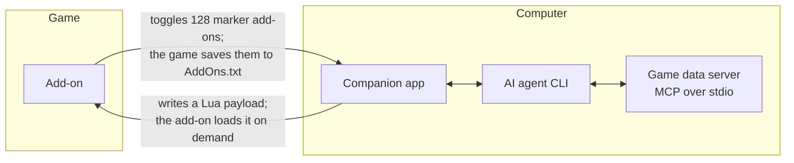

# Looking for Guidance

An in-game adviser for World of Warcraft: Forever. It adds a chat window and a field journal that know your
character — level, talents, quest log, bags, professions — and answer with sources checked against the current game,
not against fifteen-year-old guides.

Every player has typed LFG. This is the other kind: looking for guidance.

> **Status: pre-release.** Developed and played on macOS. The Windows build compiles but has not been run yet, and
> for now you build the app yourself (see [Setup](#setup)).

## What it does

**Chat.** Open it with `/ask` (or `/guidance`). Ask in your own language; the adviser reads the parts of your character it needs and
searches current sources before answering. Shift-click items, spells and quests into the message. Each character has
its own conversations and its own memory of decisions ("I am saving for the mount", "keep the linen").

**Journal.** Eight sections of advice for your character. What the game itself knows is shown at once; what needs
research is prepared when you press the section's button — or by itself, if you switch research to automatic:

| Section | What you get |
| --- | --- |
| Check-up | Unspent talent points, spells waiting at the trainer, empty slots, worn gear, missing food buff, profession caps |
| What changed | Blizzard's hotfixes that touch your class, professions, zone or quest log — each with the exact quote |
| Route | The next stop for the quests you carry |
| Where to level | Zones and dungeons for your next five levels, with quieter alternatives |
| Quest check | Is this quest bugged, changed, or am I missing something? Verdicts come with a quoted source |
| Bags | What to sell, auction, bank, use or keep, judged by tooltips, your professions and your notes |
| Gold and training | Which ranks are worth buying, what to skip, and whether you will afford the mount |
| Dungeons | Quests to pick up before you enter, where to get them, and tips for a first run |

Every prepared answer shows its sources and when it was checked, and says so when a source is not about Forever.

The interface follows the game's language: English, German, French, Spanish, Brazilian Portuguese, Korean,
Simplified and Traditional Chinese, and Russian.

## How it works

Add-ons cannot open files or sockets, so the two halves talk through the only doors the game leaves open:



- **Game → computer.** The add-on encodes each message as 16-byte frames in the enabled/disabled state of 128 marker
  add-ons and asks the game to save the add-on list. The companion watches `AddOns.txt` and decodes the frames. A
  frame lives on disk for 40 ms and the companion reads it from outside, so every 48 data frames are followed by six
  check frames: any six frames missed in a row are rebuilt, and a packet that still does not arrive is sent again.
- **Computer → game.** The companion writes one Lua file. The add-on reads it by loading a fresh load-on-demand
  add-on each time — 512 of them per interface session.
- **Advice.** The companion runs an agent you already have: the [Codex CLI](https://learn.chatgpt.com/docs/codex/cli)
  or [Claude Code](https://code.claude.com/docs/en/setup). You choose one in the companion's menu and everything
  goes to it — chats and journal research alike. Either way the agent is confined to the adviser's role: it reads
  character data through a local MCP server, searches the web and reads pages, and can do nothing else. Nothing but
  the question and the tool results it asks for leaves the computer.
- **Journal research** runs as hidden one-shot jobs with a fixed output schema. The companion validates every answer
  in Go — quotes must appear in the fetched text, IDs must be ones the game sent, links must be `https` — and caches
  it on disk.

The adviser's standing instructions are in [helper/game-adviser.md](helper/game-adviser.md).

## Cost and privacy

- Advice uses **your own** subscription: a Claude plan through Claude Code, or a ChatGPT plan through the Codex CLI.
  One of them is enough. There is no server of ours and no account to create.
- What is sent to the model: your question, and the sections of the character snapshot the agent requests. You
  choose the allowed sections in *Settings → Character data*.
- Journal research spends the same allowance, so by default it runs **only when you press a button** in a section.
  *Settings → Advisor* has the switch to *Automatic*: then the hotfix digest and class advice are prepared after
  login and the other sections when you open them. The same page sets how many research jobs may run in a day
  (60 unless you change it, 200 at most). Answers are cached on disk, so asking again for the same thing is free
  until the answer goes stale.
- The chat footer's tooltip shows which adviser answers and how much of its allowance is left, when the provider
  reports that: Codex through its account limits, Claude Code after each turn.
- Conversations, snapshots, memory and cached research stay on your disk.

## Setup

For now you build it yourself.

**You need:** macOS, the game client with a `_forever_` folder, Xcode command line tools, Go (the toolchain named
in `go.mod`), Python 3, and **one** of the two agents: Claude Code with a Claude plan, or the Codex CLI with a
ChatGPT plan. Lua is needed only for the tests.

```sh
./tools/build-macos.sh                     # builds and ad-hoc signs dist/Looking for Guidance.app
python3 tools/install-local-macos.py       # installs the app and the add-on; close the game first
```

Start the app, pick the game folder from its menu bar icon, and let it install the add-on. In the game, type `/ask`.

The adviser is chosen in the menu under *Adviser*, and everything goes to the one you chose. If you have only
Claude Code installed, the companion uses it without asking; nothing of Codex is started or created.

**With Claude Code** there is nothing else to set up: sign in once with `claude auth login`. The companion starts
Claude Code without your own Claude settings, memory files, skills or MCP servers, so the adviser behaves the same
on every machine.

**With Codex**, the companion keeps the adviser apart from your own Codex setup in a profile it creates itself on
first use (`~/Library/Application Support/Looking for Guidance Codex/config.toml`: read-only sandbox, no shell, live
web search, the game data server). That profile has its own sign-in: when the menu says *Codex is not signed in to
ChatGPT*, choose *Sign in to ChatGPT…* and finish in the browser. An existing profile is never rewritten, so you can
change its default model there.

### Settings

The menu covers the everyday choices. The rest lives in `~/Library/Application Support/Looking for Guidance/settings.json`:

| Key | Meaning |
| --- | --- |
| `wowDir` | The game folder, ending in `_forever_` |
| `runWithWoW` | Start and quit the companion together with the game |
| `provider` | `"claude"` for Claude Code; absent for Codex. Set by the *Adviser* menu, and by the first start when only Claude Code is installed |
| `codexPath` | Full path of the Codex CLI when it is not on `PATH` |
| `language` | Language of the companion's menu, such as `"ru"` or `"de"`; by default it follows the system |
| `gameDir` | The agent's working folder; chats are tied to it, so it only matters when moving an existing setup |
| `hotfixUrl` | Address of Blizzard's hotfix article, if it moves |

## Known issues

- The companion can miss frames while the game is busy. Up to six in a row are rebuilt from check frames and a
  packet that is still incomplete is sent once more, so the worst case is a delay; `helper.log` records every miss.
- Claude Code as the adviser has had less play than Codex. In the game it has answered chat questions with the
  character's data and prepared the hotfix digest; the other kinds of journal research were checked outside the
  game only.

## Development

| Path | Contents |
| --- | --- |
| `looking-for-guidance/` | The Lua add-on: interface, journal cards, translations, fonts and artwork |
| `helper/` | The companion in Go: transport, agent sessions, MCP server, journal research, tray |
| `tools/` | Build and local install scripts, emoji atlas and journal artwork generators |
| `test/`, `samples/` | Lua test harness that stands in for the game client, installer checks, sample payloads |

```sh
go test ./...
for t in test/*.lua; do [ "$t" = test/wow.lua ] || lua "$t" || break; done
python3 test/install_quiesce.py && python3 test/install_addon_payload.py
```

Two checks talk to the real world and are off by default:

- `FOREVER_LIVE=digest go test -run TestLiveInsight -v ./helper` runs one journal research job against the real
  agent and the real hotfix page (`quest`, `brief`, `dungeon`, `bags` and `leveling` work too). It spends allowance.
  Add `FOREVER_LIVE_AGENT=claude` to run it through Claude Code.
- `FOREVER_FRAMES=/Volumes/GameDisk go test -run TestFrameSoak -v ./helper` writes `AddOns.txt` to a temporary
  folder on that disk the way the game does and reads it with the companion's own watcher.

Journal artwork is drawn by `tools/build-journal-art.py` from nothing but numbers; icons are the game's own,
referenced by path.

## Roadmap

- Signed and notarized macOS build, Windows build, ready-made releases

## Licence and credits

Looking for Guidance is free software under the [GNU General Public License v3.0](LICENSE). It is a modified version
of [thott.bot chat 0.4.5](https://github.com/thott-bot/chat/releases/tag/v0.4.5), Copyright © 2026 Eden Blue
Ventures LLC; [NOTICE.md](NOTICE.md) lists what changed and the licences of bundled fonts and emoji.

World of Warcraft and Blizzard Entertainment are trademarks or registered trademarks of Blizzard Entertainment, Inc.
This project is not affiliated with or endorsed by Blizzard Entertainment.
